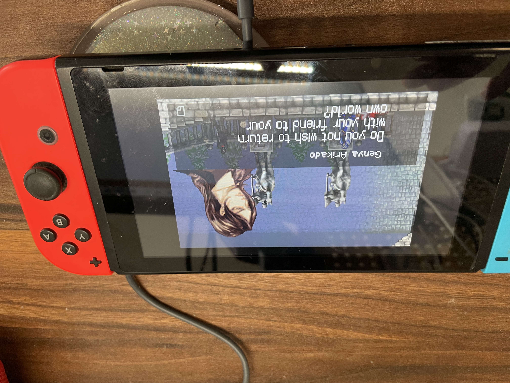

**2024年4月版**
### 必要文件
<link-preview url="https://app.notion.com/p/2ef28aa7717d43648cebaa7e54143f23#2b72f1c55c9a41eda6264360c64086f3" source="https://www.dropbox.com/scl/fo/i6dgjz4ruuqlmhe62ba4t/ADEaO7SCHR4OVlyJ5qtdsbI?rlkey=cl0c4vs087cwg1970cyiaa8du&amp;dl=0" />
- TegraRcmGUI_v2.6_Installer.msi 是注入的软件，安装在 PC 上，并去 Settings 安装驱动
- deepsea-minimal_v4.9.0.zip 解压缩，复制到 SD（<link-preview url="https://app.notion.com/p/2ef28aa7717d43648cebaa7e54143f23#c0067c79cd9f4bc6be599066b2e93cfa" source="https://github.com/Team-Neptune/DeepSea" />)
### 连接阻断器并注入
- 我买的阻断器
- 注入 payload <link-preview url="https://app.notion.com/p/2ef28aa7717d43648cebaa7e54143f23#a2695f7835a24b11b22c3a708c42afef" source="https://www.dropbox.com/scl/fi/xu1l01krplyk05kt75h7s/hekate_ctcaer_6.0.7.bin?rlkey=robyktyqd5tx0yumlumd4857f&amp;dl=0" />
### 备份
备份原始 SD 卡防止变砖。
### 启动
目前试了第一个，按住右上大键，随便启动（A 按钮）一个应用（相册）进入自制系统。
### GBA 模拟器
- 安装 mGBA
- 下载 ROM，打开，enjoy

