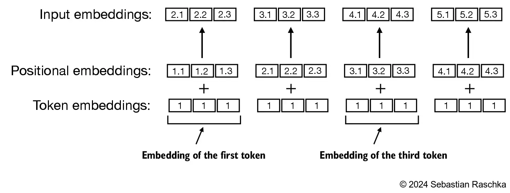

LLM 在预训练时不可能直接训练原始文本，由于文本并不能直接参与计算，需要利用“嵌入”技术把原始文本转换为张量。LLM 往往使用自己训练的嵌入模型（权重，不是分词器），而不是用 Word2Vec ，是因为其对特定任务进行了优化。

下载数据。
<span color="orange_bg">需要构建所谓的“嵌入”作为输入，输入嵌入 = 单词嵌入+ 位置嵌入。</span>
嵌入是由两部分组成的，首先来解决单词嵌入。
**单词嵌入**
单词嵌入其实就是把单词翻译成向量的过程，因为语料是中文所以采用 ChatGLM 的分词器，负责把一个长句子中按照他的规则进行分词，并提供类似 ***20119*** 的索引。
```python
tokenizer = ChatGLMTokenizer(vocab_file='../chatglm_tokenizer/tokenizer.model')

text_id=tokenizer.encode(text,add_special_tokens=False)
text_id.append(tokenizer.special_tokens['<eos>'])
```
然后通过矩阵变换转换成向量(output_dim = 256)。
```bash
vocab_size=64793
output_dim = 256
token_embedding_layer = torch.nn.Embedding(vocab_size, output_dim)
```
**位置嵌入**
位置嵌入有多种，绝对位置嵌入是其中最简单的，也是 GPT-2 采用的，所以我们只需要创建另一个嵌入层。
```python
context_length = max_length
pos_embedding_layer = torch.nn.Embedding(context_length, output_dim)

pos_embeddings = pos_embedding_layer(torch.arange(max_length))
# torch.arange(max_length) -> tensor([0, 1, 2, 3])
print(pos_embeddings.shape)
```

把二者加起来就是最终结果。
```python
input_embeddings = token_embeddings + pos_embeddings
```
### 运行代码
```bash
cd 02/
python .\main.py
```
> <link-preview url="https://app.notion.com/p/12f0657e3ba34974938a16ac03eb341a#f94f8362e1784087bcca004ae7211207" source="https://github.com/buhe/LLMs-from-scratch-zh/blob/main/02/main.py" />
