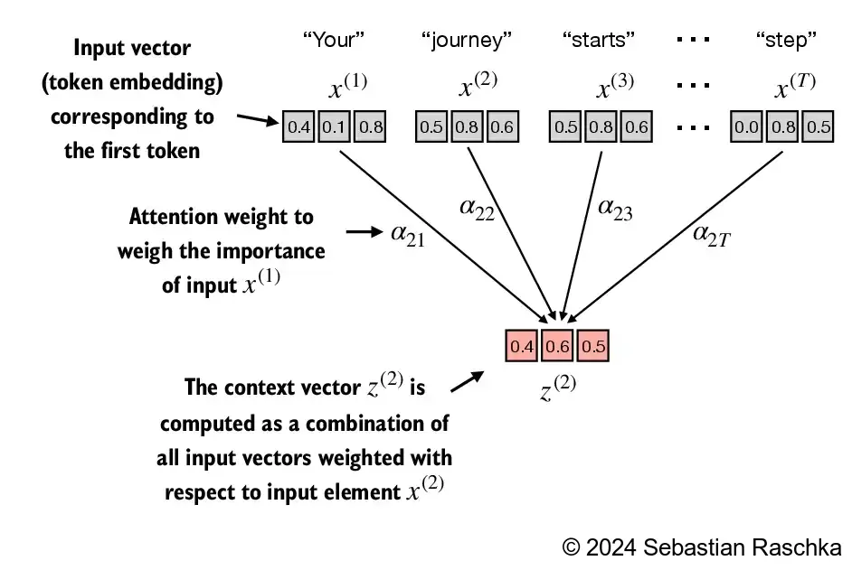
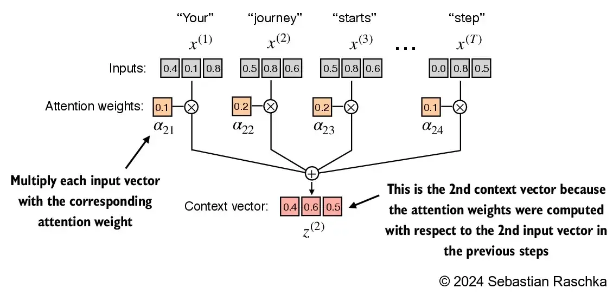

先来构建 transformers 层，其中最重要的是自注意力机制。它使序列中的每个位置能够与同一序列中的每个其他位置接合并确定其相关性。
### <span color="orange_bg">自注意力机制</span>
**没有可训练权重的注意力（简化版）**
来用第二个单词（也就是 journey）举例子，先来计算他跟其他单词的相关性分数（注意力分数）。

```python
import torch

inputs = torch.tensor(
  [[0.43, 0.15, 0.89], # Your     (x^1)
   [0.55, 0.87, 0.66], # journey  (x^2)
   [0.57, 0.85, 0.64], # starts   (x^3)
   [0.22, 0.58, 0.33], # with     (x^4)
   [0.77, 0.25, 0.10], # one      (x^5)
   [0.05, 0.80, 0.55]] # step     (x^6)
)
query = inputs[1]  # 2nd input token is the query

attn_scores_2 = torch.empty(inputs.shape[0])
for i, x_i in enumerate(inputs):
    attn_scores_2[i] = torch.dot(x_i, query) # dot product (transpose not necessary here since they are 1-dim vectors)

print(attn_scores_2)
```
> <span color="yellow_bg">注意力计算本质就是计算点积</span>
> <span color="yellow_bg">点积本质上是将两个向量元素相乘并将结果乘积求和的简写，最终得到标量（就是一个数）</span>
***注意力权重最后需要归一化，按照惯例，非归一化的注意力权重被称为“注意力分数”，而归一化的注意力分数（总和为 1）被称为“注意力权重”***
进行归一化（娱乐版）。
```python
attn_weights_2_tmp = attn_scores_2 / attn_scores_2.sum()

print("Attention weights:", attn_weights_2_tmp)
print("Sum:", attn_weights_2_tmp.sum())
```
实际会使用 pytorch 的 softmax 进行归一化，该函数在处理极端值方面更好，并且在训练期间具有更理想的梯度属性。
```python
attn_weights_2 = torch.softmax(attn_scores_2, dim=0)

print("Attention weights:", attn_weights_2)
print("Sum:", attn_weights_2.sum())
```
最终结果计算他的上下文向量，通过将嵌入的输入标记与注意力权重相乘来计算上下文向量，并将结果向量求和。

```python
query = inputs[1] # 2nd input token is the query

context_vec_2 = torch.zeros(query.shape)
for i,x_i in enumerate(inputs):
    context_vec_2 += attn_weights_2[i]*x_i

print(context_vec_2)
```
<span color="yellow_bg">计算了输入 2 的注意力权重和上下文向量，接下来，推广此计算以计算所有注意力权重和上下文向量。</span>
### **使用可训练的权重实现自我注意力**
与前面最显着的区别是引入了在模型训练期间更新的注意力权重矩阵。
初始化三个权重矩阵
```python
torch.manual_seed(123)

W_query = torch.nn.Parameter(torch.rand(d_in, d_out), requires_grad=False)
W_key   = torch.nn.Parameter(torch.rand(d_in, d_out), requires_grad=False)
W_value = torch.nn.Parameter(torch.rand(d_in, d_out), requires_grad=False)
# shape is 3 * 2
```
> 出于说明目的，我们设置 `requires_grad=False` 了减少输出中的干扰，但是如果我们要使用权重矩阵进行模型训练时，我们将设置为 `requires_grad=True` 在模型训练期间更新这些矩阵
接下来，计算查询、键和值向量
```python
keys = inputs @ W_key 
values = inputs @ W_value

print("keys.shape:", keys.shape)
print("values.shape:", values.shape)
# keys.shape: torch.Size([6, 2])
# values.shape: torch.Size([6, 2])
```
还是以第二个输入为例子
```python
attn_scores_2 = query_2 @ keys.T # All attention scores for given query
print(attn_scores_2)
```
<span color="yellow_bg">下一步进行归一化，与前面的区别在于，我们现在通过将注意力分数除以嵌入维度的平方根来缩放注意力分数</span>
```python
d_k = keys.shape[1]
attn_weights_2 = torch.softmax(attn_scores_2 / d_k**0.5, dim=-1)
print(attn_weights_2)
```
最后得出输入 2 的上下文向量（首次引入 value）
```python
context_vec_2 = attn_weights_2 @ values
print(context_vec_2)
```
### **用因果关系隐藏未来预测**
上述的注意力算法有什么缺点？缺点是：在计算某个单词注意力时，会计算他和后面单词的注意力。
那怎么解决？就是让输入后面的注意力上下文乘以 0 。
```python
tensor([[1., 0., 0., 0., 0., 0.],
        [1., 1., 0., 0., 0., 0.],
        [1., 1., 1., 0., 0., 0.],
        [1., 1., 1., 1., 0., 0.],
        [1., 1., 1., 1., 1., 0.],
        [1., 1., 1., 1., 1., 1.]])
```
然后再进行归一化。
而实际中，可以在对角线上方的非规范化注意力分数进入 softmax 函数之前，用<span color="yellow_bg">负无穷大</span>来掩盖对角线上方的未归一化注意力分数，而不是将对角线上方的注意力权重归零并重新规范化结果。
```python
mask = torch.triu(torch.ones(context_length, context_length), diagonal=1)
masked = attn_scores.masked_fill(mask.bool(), -torch.inf)
attn_weights = torch.softmax(masked / keys.shape[-1]**0.5, dim=-1)
```
为什么使用 -inf
### 使用 dropout
增加 dropout 层，目的是为防止模型过拟合，举个例子就是防止<span color="yellow_bg">鹦鹉学舌</span>。方法是随机去掉一些权重。
### **将单头注意力扩展到多头注意力**
不过从上面的计算结果还可以看到一点就是，**「模型在对当前位置的信息进行编码时，会过度的将注意力集中于自身的位置」**（虽然这符合常识，但并不正确）而可能忽略了其它位置。因此，采取的一种解决方案就是采用多头注意力机制（MultiHeadAttention）（多头注意力背后的主要思想是使用不同的、学习到的线性投影多次（并行）运行注意力机制。这允许模型共同处理来自不同位置的不同表示子空间的信息。）。
所谓的<span color="yellow_bg">多头注意力机制其实就是将原始的输入序列进行多组的自注意力处理过程</span>；然后再将每一组自注意力的结果拼接起来（cat）进行一次线性变换得到最终的输出结果。

```python
class MultiHeadAttentionWrapper(nn.Module):

    def __init__(self, d_in, d_out, context_length, dropout, num_heads, qkv_bias=False):
        super().__init__()
        self.heads = nn.ModuleList(
            [CausalAttention(d_in, d_out, context_length, dropout, qkv_bias) 
             for _ in range(num_heads)]
        )

    def forward(self, x):
        return torch.cat([head(x) for head in self.heads], dim=-1)
```
最终利用矩阵乘法进行加速
```python
class MultiHeadAttention(nn.Module):
    def __init__(self, d_in, d_out, context_length, dropout, num_heads, qkv_bias=False):
        super().__init__()
        assert (d_out % num_heads == 0), \
            "d_out must be divisible by num_heads"

        self.d_out = d_out
        self.num_heads = num_heads
        self.head_dim = d_out // num_heads # Reduce the projection dim to match desired output dim

        self.W_query = nn.Linear(d_in, d_out, bias=qkv_bias)
        self.W_key = nn.Linear(d_in, d_out, bias=qkv_bias)
        self.W_value = nn.Linear(d_in, d_out, bias=qkv_bias)
        self.out_proj = nn.Linear(d_out, d_out)  # Linear layer to combine head outputs
        self.dropout = nn.Dropout(dropout)
        self.register_buffer(
            "mask",
            torch.triu(torch.ones(context_length, context_length),
                       diagonal=1)
        )
        # 具体作用下面有详细解释

    def forward(self, x):
        b, num_tokens, d_in = x.shape

        keys = self.W_key(x) # Shape: (b, num_tokens, d_out)
        queries = self.W_query(x)
        values = self.W_value(x)

        # We implicitly split the matrix by adding a `num_heads` dimension
        # Unroll last dim: (b, num_tokens, d_out) -> (b, num_tokens, num_heads, head_dim)
        keys = keys.view(b, num_tokens, self.num_heads, self.head_dim) 
        # 具体作用下面有详细解释
        values = values.view(b, num_tokens, self.num_heads, self.head_dim)
        queries = queries.view(b, num_tokens, self.num_heads, self.head_dim)

        # Transpose: (b, num_tokens, num_heads, head_dim) -> (b, num_heads, num_tokens, head_dim)
        keys = keys.transpose(1, 2)
        queries = queries.transpose(1, 2)
        values = values.transpose(1, 2)

        # Compute scaled dot-product attention (aka self-attention) with a causal mask
        attn_scores = queries @ keys.transpose(2, 3)  # Dot product for each head

        # Original mask truncated to the number of tokens and converted to boolean
        mask_bool = self.mask.bool()[:num_tokens, :num_tokens]

        # Use the mask to fill attention scores
        attn_scores.masked_fill_(mask_bool, -torch.inf)
        
        attn_weights = torch.softmax(attn_scores / keys.shape[-1]**0.5, dim=-1)
        attn_weights = self.dropout(attn_weights)

        # Shape: (b, num_tokens, num_heads, head_dim)
        context_vec = (attn_weights @ values).transpose(1, 2) 
        
        # Combine heads, where self.d_out = self.num_heads * self.head_dim
        context_vec = context_vec.contiguous().view(b, num_tokens, self.d_out)
        context_vec = self.out_proj(context_vec) # optional projection

        return context_vec
```
`register_buffer` 的用处
view 的作用
### 运行代码
```bash
cd 03/
python .\main.py
```
> <link-preview url="https://app.notion.com/p/29f3595ebaf24f9f924a8a26a2ba012f#f8e717d4378747b38ac16821414455a1" source="https://github.com/buhe/LLMs-from-scratch-zh/blob/main/03/main.py" />
