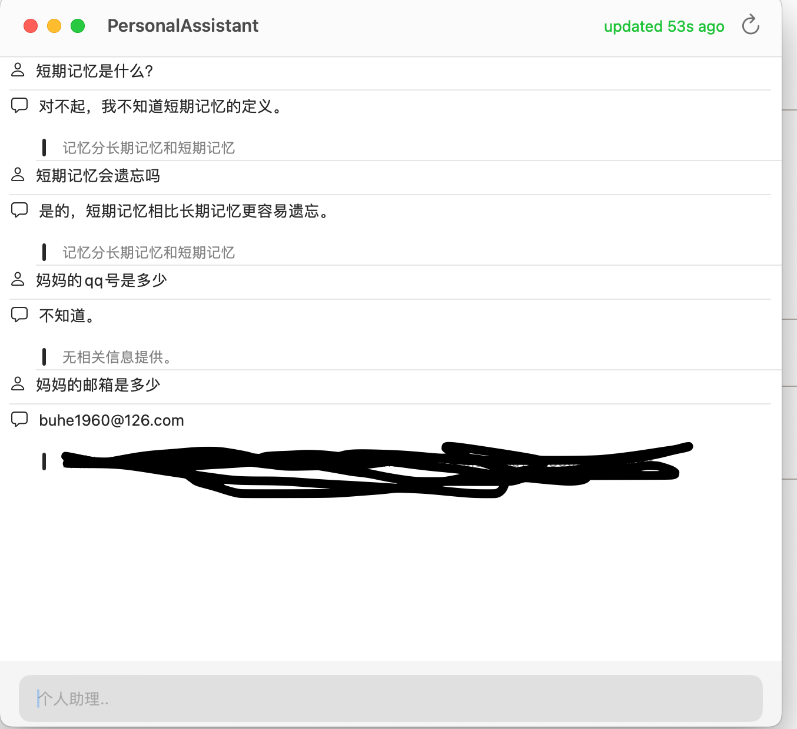

- **我受启发产生的一些观点**
	- **AI 即将改变组织知识的方式，从实体笔记到数字笔记有了搜索引擎来更快的检索知识，而AI可以帮助我们更好的检索信息，未来每个笔记软件都必须会有AI，否则将遭到淘汰。**
		- **应该用我自己开发的软件把数据汇聚起来，利用 AI 回答问题。**
	- **要努力消除信息孤岛，需要数据的软件尽量少用，现在的软件不够开放。**
	- **人生的全部意义就是对抗虚无，无时无刻不在做自己认为有意义的事情，只要一直在履行，则做什么都是对的。**
	- **人脑只能记住很少的东西，所以要取其精华。**
	- **一旦产生共鸣了，就应该记录下来。因为直觉是有科学依据的。**
	- 对于脑力工作者而言，专注力是最稀缺、宝贵的资源。
- 书中的信息抓取的准则
	- 启发性
	- 实用性
	- 个性
	- 新奇性
- 书中的工作流
	- 抓取
	- 加粗
	- 高亮
	- 纲要（可选，当特别重要时）
- 我结合自己的实际情况的工作流
	- flomo 随意记录，作为收件箱
	- notion 记录、分类
	- 我自己开发的 AI 工具，基于 notion 回答问题 
		
	- tmdb 记录影音信息，因为有 API
	- 书使用 calibre 
		- 设置 wait done 两个 list
		- 通过 API 解析 tags → http://\[::1\]:8080/interface-data/books-init?library_id=calibre&sort=timestamp.desc&1710216462369
	- 文件放在 dropbox 和 google drive 中 ，如 <link-preview url="https://app.notion.com/p/06fee5e310a04b54ab3874443f36e3e6#52af4fa5953c461b800b4d8153e2ef4a" source="https://www.dropbox.com/scl/fi/92o2mxjtgiwckcarb5grn/650753.png?rlkey=dhem2odw7cz4qk1dpuen4057l&amp;dl=0" /> <link-preview url="https://app.notion.com/p/06fee5e310a04b54ab3874443f36e3e6#3acdd54bffad49f18bf54d723250858e" source="https://drive.google.com/file/d/13kZNXK3UGLxjqwRM63h37mCCI4z-essr/view?usp=drive_link" />
- 书中所谓的半熟素材，其实类似资源
	- 干货笔记
	- 落选素材
	- 过程性文件
	- 最终成果
	- 他山之石
	
	
读《财务报表分析》
