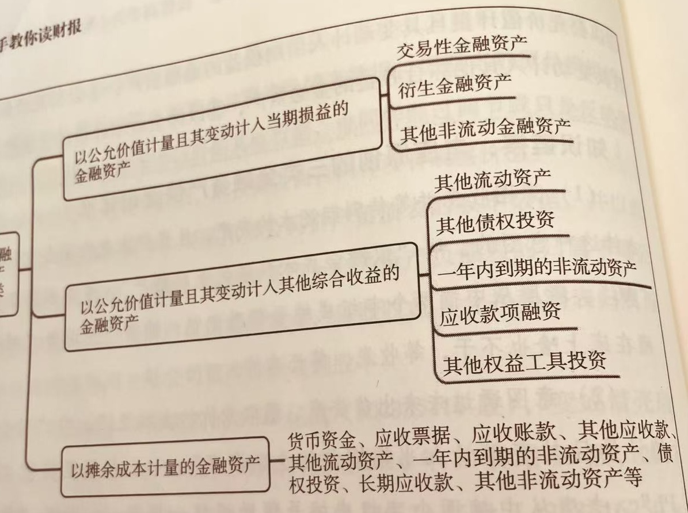

投资类资产应该是唐朝先生为了方便分类自定义的分类，其在新旧准则下变化很大，书中说从四种变为三种，看起来是变简化了。我在看了变化前和变化后的财报并没有搞清逻辑，后来通过询问 AI 和仔细理解才搞明白。
简单一句话说明，其实不是由四种变三种，而是三种变十几种（指资产负债表科目），而这十几种属于三大类。
唐朝先生为了方便记忆称为摊子，笋子，粽子，以上十几种科目的会计处理方法遵循这三大类。
- 笋子
	- 自报表日起超过一年到期（或无固定期限）且预期持有会超过一年的部分，单独列为“其他非流动金融货产”
	- 通过公允价值变动影响利润表，处理规则与原准则下的“交易性金融资产”一样
- 摊子
	- 其处理规则和原准则下的“持有至到期投资”完全一样
	- 不影响利润表（分红和利息通过投资收益影响利润表）
- 粽子
	- 对应的是原准则下的“可供出售金融资产”
	- 不影响利润表，影响综合收益，在净利润之后。
这是我的理解，可能有误，欢迎指正。

