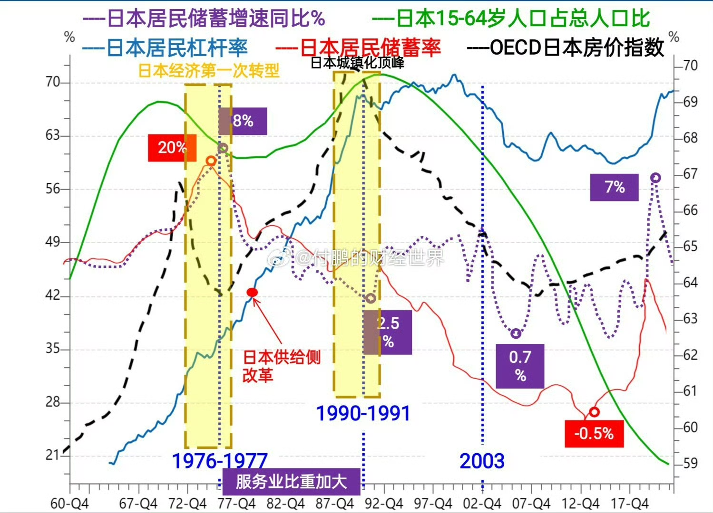
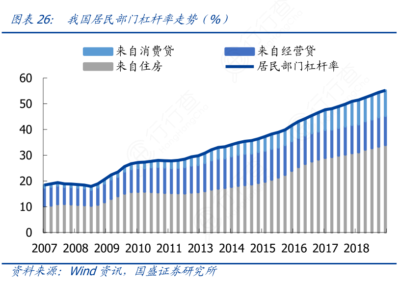

当时的政策空间，名义利率是多少？2.5%-4.25%-6%
房价跌了多少？而日本楼市崩盘后[房价](https://m.fang.com/fangjia//?ztzh_uuid=wap_news16859571)跌80%
城镇化率？77%-91%，1988-2018
PPI？
负债率？占GDP？
出口？
人口老龄化？在1989年，老龄人口占日本人口比例为11.6%，预计在2030年会攀升到25.6%，然而事实上，现在这一数字已经达到27.3%。
<table>
<tr>
<td>年</td>
<td>0－14岁</td>
<td>15－64岁</td>
<td>65岁以上</td>
</tr>
<tr>
<td>2020</td>
<td>12.2%</td>
<td>60.5%</td>
<td>27.3%</td>
</tr>
<tr>
<td>2010</td>
<td>13.3%</td>
<td>64.1%</td>
<td>22.6%</td>
</tr>
<tr>
<td>2009</td>
<td>13.5%</td>
<td>64.3%</td>
<td>22.2%</td>
</tr>
<tr>
<td>2008</td>
<td>13.7%</td>
<td>64.7%</td>
<td>21.6%</td>
</tr>
<tr>
<td>2007</td>
<td>13.8%</td>
<td>65.2%</td>
<td>21%</td>
</tr>
</table>
中国：2023年末，全国0—15岁人口为24789万人，占全国人口的17.6%；16—59岁劳动年龄人口为86481万人，占61.3%；60岁及以上人口为29697万人，占21.1%，其中65岁及以上人口为21676万人，占15.4%。
租售比，代表房地产泡沫，1988，1.6%-4.5%
日本不跳槽，和中国情况不同
中国的汇率为什么不跌
中国汇率不大幅下跌有多方面的原因，主要可以归结为以下几个因素：
### 1. **央行的调控**
中国人民银行（央行）对人民币汇率实施了有管理的浮动汇率制度。尽管人民币汇率在一定程度上受市场供求关系的影响，但央行仍然会通过外汇储备干预或调整货币政策来稳定汇率。例如，如果人民币面临较大贬值压力，央行可能会通过抛售外汇储备或提高利率来支撑汇率。
### 2. **资本管制**
中国对资本流动有严格的管控，尤其是跨境资本流动。通过控制资本外流，中国可以减少对外汇市场的压力，避免人民币过度贬值。
### 3. **外贸顺差**
中国通常保持较大的贸易顺差，意味着出口大于进口。这种贸易顺差会带来外汇流入，支持人民币的需求，从而避免人民币的大幅贬值。
### 4. **外汇储备充足**
中国有着庞大的外汇储备，位居世界前列。当人民币面临贬值压力时，政府可以动用外汇储备进行干预，稳定汇率。这一储备为央行提供了较大的政策操作空间。
### 5. **全球经济地位和对人民币的信心**
尽管经济增速放缓或面临外部挑战，但中国仍是全球经济的重要引擎。随着人民币国际化的推进，许多国家和投资者对人民币的信心增强，这在一定程度上减少了大规模贬值的可能性。
### 6. **美元的相对强势**
人民币汇率在很大程度上与美元挂钩。当美元强势时，人民币也可能随之承压。但中国通过货币政策的调整，可以相对稳定地维持人民币兑美元的汇率水平。
### 7. **通胀控制**
如果人民币贬值幅度过大，可能会加剧通货膨胀压力，尤其是在进口商品的价格方面。为了控制国内的通胀水平，政府也有动力维持人民币的相对稳定。
通过上述手段和政策，中国能够在面对内外部经济压力时，保持人民币汇率的相对稳定。
美国的贸易战，美国关税

日本的政策受美国直接影响，中国没有
杠杆率，代表信用泡沫
中国，经测算2024年一季度宏观杠杆率上升6.8个百分点，从2023年末的288.0%上升至294.8%。其中，居民部门杠杆率上升了0.5个百分点，从2023年末的63.5%升至64.0%；非金融企业部门杠杆率上升幅度最大，上升了5.7个百分点，从2023年末的168.4%升至174.1%；政府部门杠杆率上升了0.6个百分点，从2023年末的56.1%增长至56.7%。
日本，杠杆率：居民部门杠杆率从 1964 年的 20%提升至 1985 年的 52%，整体仍有加 杠杆空间；但非金融企业部门杠杆率从 91%提升至 108%，并在 1990 年前后提升 至 139%，企业杠杆率基本上也进入瓶颈期
07 中国泡沫
金融机构破产

