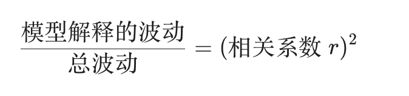

应用 numbers
- 选中目标单元格，输入 `=` 符号。
- 输入 **`CORREL`**（相关系数）。
- 由于「解释力度」就是「相关系数的平方」，你直接用这个公式，兼容性最强： `=POWER(CORREL(B2:B20, A2:A20), 2)`

「相关系数」衡量的是**关联的紧密程度**（方向和强度），而「相关系数的平方」（R2）衡量的是**方差的占比**（即能量的分配）。
在统计学中，我们衡量「波动」的大小不是看数值之差，而是看**方差（Variance）**。
- 波动（误差）是以**平方形式**累加的（为了消除正负号，并放大偏离较大的点）。
- 当我们做一个线性回归模型时，总波动可以拆解为两部分：

- 数学上可以证明，在简单线性回归中：

- 如果相关系数 r=0.7，那么 R2=0.7×0.7=0.49。
	- 这意味着尽管两个指标看起来「挺相关」的，但实际上 TIPS 指数的变动只解释了因变量波动的 **49%**，剩下的 **51%** 能量来自其他噪音或因素。
	- **平方效应**意味着：只有当相关性非常高（比如 0.9 以上）时，解释力度才会显著跳升（0.92=0.81）。
